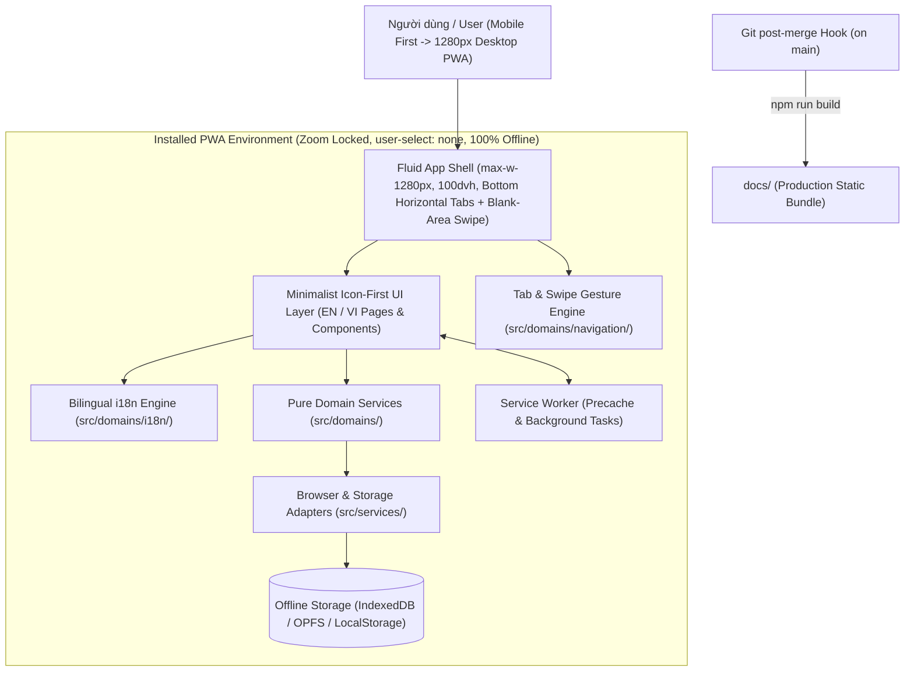
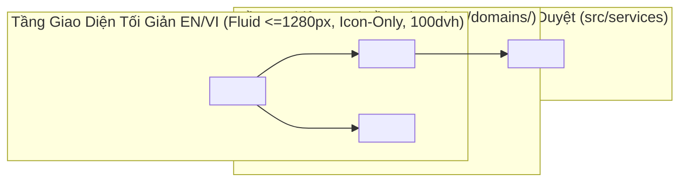

# SDD & TDD Document, README, UI/UX, Hook, and Configuration Templates

Use these standardized templates when initializing a project, updating documentation in `documents/`, configuring `README.md` for all AI agents, implementing the fluid minimalist bottom-tab UI, setting up the `after-merge` (`post-merge`) build hook to `docs/`, and enforcing the $\ge 90\%$ test coverage gate.

---

## 1. Root `README.md` Template (Mandatory Multi-Agent SDD & UI/UX Guide)

```markdown
# <App Name> — Bilingual (EN/VI) Offline-First PWA SPA

> **IMPORTANT FOR ALL AI AGENTS & DEVELOPERS**: This repository strictly follows **Specification-Driven Development (SDD)** and **Test-Driven Development (TDD)** (`Epic -> BR -> SA (+ ADR) -> Test (>= 90% coverage) -> Code`). Read the governance and UI/UX rules below before making any code or documentation changes.

---

## 1. SDD & TDD Governance Rules (Quy chuẩn Phát triển SDD & TDD Bắt buộc)

Every new feature, enhancement, or architectural change **MUST** follow this exact lifecycle:

```text
Epic Scope -> Business Requirement (BR) -> Solution Architecture (SA + ADR) -> Automated Tests (>= 90%) -> Code Implementation
```

### 1.1 Directory Separation: `documents/` vs `docs/`
* **`documents/` (SDD Documentation & Bundled Skill)**:
  * `documents/BR-MASTER.md`: Holistic Business Requirements & current status of the entire webapp and all Epics.
  * `documents/SA-MASTER.md`: Holistic Solution Architecture, system diagrams, module map, and ADR index of the entire webapp.
  * `documents/epics/epic-XX-<slug>/BR-EPIC-XX.md`: Business Requirements **strictly scoped ONLY** to `EPIC-XX`.
  * `documents/epics/epic-XX-<slug>/SA-EPIC-XX.md`: Solution Architecture **strictly scoped ONLY** to `EPIC-XX`.
  * `documents/adr/ADR-XXX-<slug>.md`: Architecture Decision Records. **Every SA-level change or architectural decision MUST be recorded in an ADR.**
  * `documents/skills/sdd-tdd-pwa-webapp/`: Bundled copy of the SDD+TDD Webapp Skill used to create and maintain this application.
* **`docs/` (Production Build Output Only)**:
  * Contains the compiled production PWA static bundle generated by `npm run build` (`vite build --outDir docs`).
  * Do **NOT** place markdown specifications inside `docs/`; all specifications belong in `documents/`.

### 1.2 Core Engineering & UI/UX Mandates (Yêu cầu Kỹ thuật & Giao diện Cốt lõi)
1. **PWA SPA & 100% Offline-First**:
   * Works 100% offline after initial load via Service Worker precaching and client-side storage (`IndexedDB`, `OPFS`, `LocalStorage`).
   * Uses relative paths (`base: './'`) and hash routing (`#/...`) for static hosting compatibility.
2. **Always Bilingual (English `en` & Vietnamese `vi`)**:
   * Every UI view, `aria-label`, tooltip, message, and feature MUST support both **English (`en`)** and **Vietnamese (`vi`)** via `src/domains/i18n/`.
   * Both languages must be covered by automated tests.
3. **Fluid Mobile-First Responsive (Scaling up to `1280px` Desktop)**:
   * Designed mobile-first with fluid sizing (`w-full max-w-[1280px] mx-auto`), adapting smoothly from compact phone screens up to `1280px` desktop viewports.
4. **Minimalist, Icon-Driven & Single-Screen Priority (`100dvh`)**:
   * Clean, uncluttered UI with **no verbose explanations**.
   * **Replace text buttons with icon buttons** (`lucide-react` + `aria-label` / `title`) wherever feasible.
   * Prioritize fitting each tab's primary workspace within **1 mobile screen (`100dvh`)** without vertical scrolling when feasible.
5. **Zoom Disabled**:
   * Viewport zooming is disabled (`user-scalable=no, maximum-scale=1.0, minimum-scale=1.0` in `index.html` and `touch-action: manipulation` in CSS).
6. **Bottom Horizontal Tab Bar & Swipe-to-Switch-Tab**:
   * Primary navigation uses **horizontal tabs docked at the bottom of the app**.
   * Users can **swipe left/right on blank/non-interactive areas of a tab** to switch to the next/previous tab.
7. **Non-Selectable Text by Default**:
   * All text in the app has `user-select: none` by default, **except** explicit editable or copyable CTA items (`input`, `textarea`, `[contenteditable="true"]`, `[data-selectable="true"]`).
8. **Hard Test Coverage Gate ($\ge 90\%$)**:
   * `npm run test:coverage` enforces **$\ge 90\%$** across **Lines, Statements, Functions, and Branches**.
   * Pure domain logic lives in `src/domains/`; browser side-effects live in `src/services/`.
9. **Automated `after-merge` (`post-merge`) Production Build to `docs/`**:
   * A Git `post-merge` hook (`.githooks/post-merge` -> `.git/hooks/post-merge`) is integrated so that immediately after merging into `main`, `npm run build` runs automatically and outputs the fresh production bundle into `docs/`.

---

## 2. Step-by-Step Checklist for AI Agents Adding/Modifying Features

1. **Step 1 — Define/Update Epic BR**:
   * Create or update `documents/epics/epic-XX-<slug>/BR-EPIC-XX.md` (only requirements for `EPIC-XX`, including bilingual `en`/`vi` and minimalist icon/bottom-tab/swipe acceptance criteria).
   * Sync epic status and feature pillars in `documents/BR-MASTER.md`.
2. **Step 2 — Define/Update Epic SA & ADR**:
   * Create a new `documents/adr/ADR-XXX-<slug>.md` for any SA-level change.
   * Create or update `documents/epics/epic-XX-<slug>/SA-EPIC-XX.md` (only architecture & test matrix for `EPIC-XX`).
   * Sync `documents/SA-MASTER.md` (architecture diagram, module map, ADR index).
3. **Step 3 — Write Tests First (TDD)**:
   * Add/update unit tests (`tests/*.test.ts`) and UI integration tests (`tests/*.test.tsx`) covering all acceptance criteria, swipe/tab switching, icon button `aria-label` actions, and both `en`/`vi` languages.
4. **Step 4 — Implement Code & Pass Quality Gates**:
   * Implement code in `src/domains/`, `src/services/`, `src/components/`, `src/pages/`.
   * Run `./documents/skills/sdd-tdd-pwa-webapp/scripts/verify-sdd-docs.sh` (or `npm run typecheck && npm run test:coverage && npm run build`).
   * Mark the Epic as `Implemented (Đã triển khai)` in `BR-EPIC-XX.md`, `SA-EPIC-XX.md`, `documents/BR-MASTER.md`, and `documents/SA-MASTER.md`.

---

## 3. Commands (Các lệnh Phát triển & Kiểm thử)

```bash
npm install                # Installs dependencies & configures .githooks/post-merge
npm run dev                # Start local Vite dev server
npm run typecheck          # Run TypeScript strict type checking
npm run test               # Run Vitest unit & integration tests
npm run test:coverage      # Run tests with >= 90% coverage gate (Lines/Statements/Functions/Branches)
npm run build              # Build production PWA bundle into docs/
```
```

---

## 2. `documents/BR-MASTER.md` Template

```markdown
# Master Business Requirements (BR-MASTER)
**Dự án / Project:** <Tên Dự Án / Project Name>  
**Phiên bản / Version:** <X.Y.Z>  
**Trạng thái / Status:** <Trạng thái tổng thể của Webapp hiện tại>  
**Cập nhật lần cuối / Last Updated:** <YYYY-MM-DD>  

---

## 1. Tầm nhìn & Mục tiêu Sản phẩm (Product Vision)
Mô tả mục tiêu cốt lõi của ứng dụng **Bilingual (EN/VI) Offline-First PWA SPA**, đối tượng người dùng (Target Persona) và triết lý giao diện tối giản (Minimalist Icon-Driven Single-Screen Mobile-First UI).

---

## 2. Quy trình Phát triển & Quản trị Chất lượng (SDD + TDD Governance)
Dự án tuân thủ nghiêm ngặt quy trình **Epic $\rightarrow$ BR (Business Requirement) $\rightarrow$ SA (Solution Architect + ADR) $\rightarrow$ Test $\rightarrow$ Code**:
1. **Tài liệu Trung tâm (`documents/`):**
   * `documents/BR-MASTER.md`: Phản ánh toàn bộ yêu cầu nghiệp vụ và trạng thái hiện hành của hệ thống.
   * `documents/SA-MASTER.md`: Phản ánh kiến trúc kỹ thuật tổng thể hiện hành của hệ thống.
   * `documents/adr/ADR-xxx-*.md`: Lưu vết mọi quyết định và thay đổi ở cấp độ Solution Architecture.
   * `documents/skills/sdd-tdd-pwa-webapp/`: Bản sao của skill SDD+TDD dùng để xây dựng và vận hành dự án.
2. **Phát triển theo Epic:**
   * Mỗi Epic có đúng 1 file `BR-EPIC-xx.md` và 1 file `SA-EPIC-xx.md` riêng biệt trong `documents/epics/epic-xx-*/`, chỉ mô tả phạm vi của Epic đó.
3. **Song ngữ Anh/Việt (Bilingual EN/VI) & Giao diện Tối giản:**
   * Hỗ trợ chuyển đổi tức thì giữa Tiếng Anh (`en`) và Tiếng Việt (`vi`) cả khi offline.
   * Fluid responsive ưu tiên mobile (thu gọn trong 1 màn hình `100dvh` nếu khả thi) và scale lên đến `1280px` trên desktop; dùng icon thay nút chữ; tắt zoom; thanh horizontal tab ở đáy app hỗ trợ swipe qua lại trên vùng trống; khóa bôi đen chữ (`user-select: none`) trừ ô nhập liệu/CTA.
4. **Cam kết Chất lượng Kiểm thử (Test Coverage Gate $\ge 90\%$) & Build Tự động (`docs/`):**
   * Code coverage tự động bắt buộc đạt **$\ge 90\%$** (Lines, Statements, Functions, Branches).
   * Tích hợp Git hook `after-merge` (`post-merge`) tự động chạy `npm run build` xuất bản build production vào thư mục `docs/` ngay sau khi merge vào nhánh `main`.

---

## 3. Các Trụ cột Tính năng Cốt lõi (Core Functional Pillars)
### 3.1 Trụ cột 1: <Tên Trụ Cột>
* Mô tả tổng quan chức năng hiện có của hệ thống.

---

## 4. Yêu cầu Phi chức năng (Non-Functional Requirements)

| Mã NFR | Hạng mục | Yêu cầu chi tiết |
| :--- | :--- | :--- |
| **NFR-01** | **Kiến trúc PWA & SPA** | Single Page Application có `manifest.webmanifest` và Service Worker, cài đặt được lên thiết bị. |
| **NFR-02** | **Hoạt động Offline 100%** | Sau lần tải đầu tiên, toàn bộ tính năng và dữ liệu cục bộ hoạt động mượt mà khi ngắt kết nối Internet. |
| **NFR-03** | **Song ngữ Anh/Việt (EN/VI)** | Hỗ trợ đầy đủ Tiếng Anh (`en`) và Tiếng Việt (`vi`) trên toàn bộ giao diện, `aria-label` và luồng người dùng. |
| **NFR-04** | **Fluid Responsive & Single-Screen Minimalist UI** | Mobile-first fluid layout scale đến `1280px` cho desktop; giao diện gọn gàng không giải thích dài dòng; thay nút chữ bằng icon; ưu tiên thu gọn trong 1 màn hình điện thoại (`100dvh`). |
| **NFR-05** | **Bottom Horizontal Tabs & Swipe Navigation** | Điều hướng chính dạng horizontal tab đặt dưới đáy app; hỗ trợ quẹt ngang (swipe) vào vùng trống của tab để chuyển qua lại giữa các tab. |
| **NFR-06** | **Khóa Zoom & Khóa Select Chữ** | Tắt hoàn toàn khả năng zoom (`user-scalable=no`); toàn bộ chữ không select được (`user-select: none`) trừ các phần tử CTA/editable (`input`, `textarea`, `[contenteditable]`, `[data-selectable="true"]`). |
| **NFR-07** | **Độ phủ Kiểm thử ($\ge 90\%$)** | Ngưỡng cứng $\ge 90\%$ trên cả 4 chỉ số: Lines, Statements, Functions, Branches. |
| **NFR-08** | **Tự động Build Prod sau Merge (`docs/`)** | Hook `after-merge` (`post-merge`) tự động build bản production vào `docs/` ngay khi merge vào `main`. |

---

## 5. Lộ trình & Trạng thái Các Epic (Epic Status Roadmap)

| Mã Epic | Tên Epic | Mô tả Phạm vi | Tài liệu BR / SA | Trạng thái |
| :--- | :--- | :--- | :--- | :--- |
| **EPIC-01** | <Tên Epic 1> | <Tóm tắt phạm vi> | [BR-EPIC-01](epics/epic-1-slug/BR-EPIC-01.md) / [SA-EPIC-01](epics/epic-1-slug/SA-EPIC-01.md) | **Đã triển khai** |
```

---

## 3. `documents/SA-MASTER.md` Template

```markdown
# Master Solution Architecture (SA-MASTER)
**Dự án / Project:** <Tên Dự Án / Project Name>  
**Phiên bản / Version:** <X.Y.Z>  
**Trạng thái / Status:** <Trạng thái kiến trúc hiện hành>  
**Cập nhật lần cuối / Last Updated:** <YYYY-MM-DD>  

---

## 1. Tổng quan Kiến trúc Hệ thống (System Architecture Overview)
Mô tả kiến trúc **Bilingual (EN/VI) Local-First Offline PWA Single Page Application (SPA)** với khung giao diện **Fluid Mobile-First (`<= 1280px`), Icon-Driven Single-Screen (`100dvh`), Bottom Horizontal Tab Bar & Swipe Gesture Shell**.



---

## 2. Công nghệ Sử dụng (Technology Stack)

| Tầng (Layer) | Công nghệ / Thư viện | Lý do lựa chọn (Tham chiếu ADR) |
| :--- | :--- | :--- |
| **Core Framework** | React + TypeScript (Strict Mode) | Kiểm soát kiểu chặt chẽ, dễ kiểm thử. |
| **UI / Styling & Icons** | Tailwind CSS + `lucide-react` | Thiết kế fluid responsive (`max-w-[1280px]`), `h-dvh`, thay nút chữ bằng icon trực quan. |
| **Navigation & Gestures** | Bottom Horizontal Tab Bar + Custom Blank-Space Touch/Pointer Swipe Detector | Chuyển tab nhanh bằng chạm đáy màn hình hoặc quẹt ngang trên vùng trống. |
| **Internationalization (i18n)** | Pure TypeScript Bilingual Engine (`en` / `vi`) | Hỗ trợ song ngữ Anh/Việt 100% offline, type-safe, zero runtime bloat. |
| **Build & PWA (`docs/`)** | Vite (`build.outDir: 'docs'`) + `vite-plugin-pwa` | Đóng gói SPA và Service Worker chạy offline trực tiếp vào `docs/`. |
| **Git Automation** | `.githooks/post-merge` (`after-merge`) | Tự động build production vào `docs/` ngay sau khi merge vào `main`. |
| **Offline Storage** | IndexedDB / OPFS / LocalStorage | Lưu trữ dữ liệu cục bộ bền vững. |
| **Testing & Coverage** | Vitest + Testing Library + `@vitest/coverage-v8` | Cổng chặn coverage $\ge 90\%$. |

---

## 3. Thiết kế các Phân hệ Cốt lõi (Core Module Architecture)
Mô tả trạng thái kiến trúc hiện tại của các phân hệ trong `src/domains/` (bao gồm `src/domains/i18n/` và `src/domains/navigation/`), `src/services/`, `src/sw/`, `src/components/`, `src/pages/`.

---

## 4. Cấu trúc Thư mục Dự án (Repository Structure)
```text
├── README.md                                   # Hướng dẫn tổng quan & Quy tắc SDD/TDD + UI cho tất cả AI Agents
├── index.html                                  # Viewport khóa zoom (user-scalable=no, maximum-scale=1.0)
├── documents/                                  # Toàn bộ tài liệu SDD, ADR, Epic & bản sao Skill
│   ├── BR-MASTER.md
│   ├── SA-MASTER.md
│   ├── adr/
│   ├── epics/
│   └── skills/sdd-tdd-pwa-webapp/
├── docs/                                       # Kết quả build production (tự động cập nhật sau khi merge vào main)
├── .githooks/post-merge                        # Hook after-merge tự động chạy npm run build vào docs/
├── src/
└── tests/
```

---

## 5. Chiến lược Đảm bảo Độ phủ Kiểm thử $\ge 90\%$ (Test Coverage Strategy)
1. **Tách biệt Pure Domain Logic (`src/domains/`) và Browser Side-effects (`src/services/`)**.
2. **Kiểm thử Song ngữ (`en`/`vi`), Swipe Tab & Icon Buttons**: Đảm bảo mọi từ khóa `en`/`vi`, thao tác swipe chuyển tab trên vùng trống và các nút icon (`aria-label`) được kiểm thử tự động.
3. **Cổng chặn cứng (`thresholds: 90`) trong `vite.config.ts`**.

---

## 6. Danh mục Hồ sơ Quyết định Kiến trúc (ADR Index)
* [ADR-001: <Tiêu đề ADR-001>](adr/ADR-001-slug.md)
```

---

## 4. `documents/epics/epic-XX-<slug>/BR-EPIC-XX.md` Template

> **Rule**: Only include requirements and acceptance criteria that belong to `EPIC-XX`.

```markdown
# Business Requirement — EPIC-XX: <Tên Epic>

* **Mã Epic:** EPIC-XX
* **Tên Epic:** <Tên Epic>
* **Trạng thái:** <Đang thiết kế | Đang triển khai | Đã triển khai>
* **Liên kết Tài liệu Chung:** [BR-MASTER](../../BR-MASTER.md) | [SA-MASTER](../../SA-MASTER.md)

---

## 1. Mục tiêu Nghiệp vụ (Business Objective)
Mô tả rõ mục tiêu nghiệp vụ riêng của `EPIC-XX` và giá trị mang lại cho người dùng.

---

## 2. Danh sách Yêu cầu Nghiệp vụ Chi tiết (Functional Requirements & Acceptance Criteria)

### FR-XX.1: <Tên Yêu Cầu Chức Năng 1>
* **Mô tả:** <User story / mô tả hành vi>
* **Tiêu chí Nghiệm thu (Acceptance Criteria):**
  * **AC-1.1:** <Tiêu chí cụ thể, có thể kiểm thử tự động>
  * **AC-1.2 (Offline & Persistence):** <Tiêu chí hoạt động offline / xử lý ngoại lệ>
  * **AC-1.3 (Song ngữ Anh/Việt - Bilingual EN/VI):** Hiển thị và hoạt động đầy đủ ở cả hai ngôn ngữ Tiếng Anh (`en`) và Tiếng Việt (`vi`).
  * **AC-1.4 (Minimalist Icon UI, Bottom Tab & Swipe):** Giao diện gọn trong 1 màn hình điện thoại (nếu khả thi), scale fluid tới `1280px`, sử dụng nút icon (`aria-label`), hỗ trợ swipe chuyển tab khi quẹt vào vùng trống và không cho phép bôi đen chữ ngoài vùng editable/CTA.

---

## 3. Phạm vi Loại trừ (Out of Scope for EPIC-XX)
* Liệt kê ngắn gọn những gì thuộc các Epic khác để giữ phạm vi `EPIC-XX` độc lập và rõ ràng.

---

## 4. Tiêu chuẩn Chất lượng & Kiểm thử (Quality & Coverage Requirements)
* Toàn bộ mã nguồn thuộc `EPIC-XX` phải có Unit Test và Integration Test (bao gồm kiểm thử song ngữ `en`/`vi`, nút icon và swipe tab) đạt **$\ge 90\%$ coverage** trên cả 4 chỉ số (`lines`, `statements`, `functions`, `branches`) thông qua `npm run test:coverage`.
```

---

## 5. `documents/epics/epic-XX-<slug>/SA-EPIC-XX.md` Template

> **Rule**: Only describe the technical solution, interfaces, bilingual i18n keys, minimalist UI layout, and test matrix for `EPIC-XX`. Any architectural change introduced here MUST also be recorded in `documents/adr/ADR-XXX-*.md`.

```markdown
# Solution Architecture — EPIC-XX: <Tên Epic>

* **Mã Epic:** EPIC-XX
* **Tên Epic:** <Tên Epic>
* **Trạng thái:** <Đang thiết kế | Đang triển khai | Đã triển khai>
* **Liên kết Tài liệu:** [BR-EPIC-XX](./BR-EPIC-XX.md) | [BR-MASTER](../../BR-MASTER.md) | [SA-MASTER](../../SA-MASTER.md)
* **ADRs Áp dụng:** [ADR-XXX](../../adr/ADR-XXX-slug.md)

---

## 1. Sơ đồ Kiến trúc Thành phần của EPIC-XX (Component Architecture)



---

## 2. Thiết kế Chi tiết các Module Kỹ thuật trong EPIC-XX

### 2.1 Cấu trúc Dữ liệu & Interfaces (`types.ts`)
```ts
// Định nghĩa rõ các interface/type phục vụ EPIC-XX
```

### 2.2 Khóa Đa Ngôn Ngữ Anh/Việt & Nhãn Icon (`src/domains/i18n/`)
* Liệt kê các khóa bản dịch `en` và `vi` (ưu tiên nhãn ngắn gọn và `aria-label` cho các nút icon) phục vụ riêng cho `EPIC-XX`.

### 2.3 Thuật toán & Logic Nghiệp vụ (`src/domains/<epic>/`)
* Mô tả chi tiết các hàm thuần (input, output, xử lý biên, độ phức tạp).

### 2.4 Bố cục Giao diện Fluid Single-Screen & Tương tác (`src/components/`, `src/pages/`)
* Mô tả bố cục mobile-first (`100dvh`), cách scale lên `1280px`, danh sách các nút icon (`lucide-react`), vùng trống nhận sự kiện swipe chuyển tab và các phần tử cho phép select/edit (`data-selectable="true"` / `input`).

---

## 3. Kế hoạch Kiểm thử & Ma trận Độ phủ ($\ge 90\%$ Coverage Plan)

| File Kiểm thử | Đối tượng được kiểm thử | Kịch bản kiểm thử chính (Ánh xạ AC trong BR-EPIC-XX) |
| :--- | :--- | :--- |
| `tests/<epicDomain>.test.ts` | `src/domains/<epic>/...` | - Kiểm thử AC-1.1, AC-1.2, các trường hợp biên, lỗi và bộ từ điển `en`/`vi`. |
| `tests/<epicUi>.test.tsx` | `src/pages/...` & `src/components/...` | - Kiểm thử thao tác nút icon (`aria-label`), swipe chuyển tab trên vùng trống, trạng thái offline và chuyển đổi ngôn ngữ `EN` $\leftrightarrow$ `VI`. |
```

---

## 6. `documents/adr/ADR-XXX-<slug>.md` Template

```markdown
# ADR-XXX: <Tiêu đề Quyết định Kiến trúc>

* **Trạng thái:** Đã chấp thuận (Accepted) | Đã thay thế bởi ADR-YYY (Superseded)
* **Ngày tạo:** <YYYY-MM-DD>
* **Liên quan đến:** [BR-MASTER](../BR-MASTER.md), [SA-MASTER](../SA-MASTER.md), [SA-EPIC-XX](../epics/epic-XX-slug/SA-EPIC-XX.md)

## 1. Bối cảnh (Context)
Mô tả bài toán kỹ thuật, ràng buộc Offline PWA SPA, hỗ trợ song ngữ Anh/Việt, giao diện tối giản fluid `<= 1280px`, hiệu năng, bộ nhớ, quy trình build `docs/` hoặc yêu cầu kiểm thử dẫn đến quyết định này.

## 2. Quyết định (Decision)
Mô tả cụ thể giải pháp kiến trúc, cấu trúc lưu trữ, giao thức hoặc thư viện được chọn.

## 3. Lý do lựa chọn (Rationale)
Giải thích vì sao giải pháp này tối ưu hơn các phương án thay thế (về khả năng chạy offline, song ngữ `en`/`vi`, trải nghiệm mobile 1 màn hình, độ phủ test $\ge 90\%$).

## 4. Hệ quả (Consequences)
* **Tích cực:** Những lợi ích đạt được.
* **Đánh đổi & Giải pháp giảm thiểu:** Những ràng buộc phát sinh và cách xử lý.
```

---

## 7. `index.html` & Global CSS Templates (Zoom Disabled & Non-Selectable Text)

### 7.1 `index.html` (Disable Zooming)
```html
<!doctype html>
<html lang="vi">
  <head>
    <meta charset="UTF-8" />
    <meta
      name="viewport"
      content="width=device-width, initial-scale=1.0, maximum-scale=1.0, minimum-scale=1.0, user-scalable=no, viewport-fit=cover"
    />
    <title>App</title>
  </head>
  <body class="bg-slate-950 text-slate-100 antialiased selection:bg-indigo-500 selection:text-white overflow-hidden">
    <div id="root"></div>
    <script type="module" src="/src/main.tsx"></script>
  </body>
</html>
```

### 7.2 `src/index.css` (Global `user-select: none`, Editable Opt-In, Single-Screen Lock)
```css
@import "tailwindcss";

@layer base {
  html,
  body,
  #root {
    width: 100%;
    height: 100dvh;
    margin: 0;
    padding: 0;
    overflow: hidden;
    touch-action: manipulation;
    -webkit-text-size-adjust: 100%;
    user-select: none;
    -webkit-user-select: none;
    -webkit-touch-callout: none;
  }

  /* Only allow text selection on editable fields or explicit copyable CTA items */
  input,
  textarea,
  [contenteditable="true"],
  [data-selectable="true"] {
    user-select: text;
    -webkit-user-select: text;
  }
}
```

---

## 8. Swipeable Bottom-Tab Navigation Pattern (`src/domains/navigation/swipeTabLogic.ts`)

Use a pure domain helper to evaluate horizontal swipe gestures on blank areas so it achieves 100% unit & integration test coverage:

```ts
export interface SwipePoint {
  x: number;
  y: number;
}

const INTERACTIVE_SELECTOR =
  'button, a, input, textarea, select, label, [role="button"], [contenteditable="true"], [data-no-swipe="true"]';

export function isBlankSwipeTarget(target: EventTarget | null): boolean {
  if (!target || !(target instanceof Element)) return true;
  return !target.closest(INTERACTIVE_SELECTOR);
}

export function resolveNextTabIndex(
  currentIndex: number,
  totalTabs: number,
  start: SwipePoint,
  end: SwipePoint,
  minSwipeDistance = 48,
  maxVerticalRatio = 0.75
): number {
  if (totalTabs <= 1) return currentIndex;
  const dx = end.x - start.x;
  const dy = end.y - start.y;
  if (Math.abs(dx) < minSwipeDistance) return currentIndex;
  if (Math.abs(dy) > Math.abs(dx) * maxVerticalRatio) return currentIndex;

  if (dx < 0) {
    // Swiped left -> next tab
    return Math.min(totalTabs - 1, currentIndex + 1);
  }
  // Swiped right -> previous tab
  return Math.max(0, currentIndex - 1);
}
```

### App Shell Layout Structure (`w-full max-w-[1280px] mx-auto h-dvh flex flex-col overflow-hidden`)
```tsx
// Inside AppShell.tsx:
// 1. Top compact header (icon actions only: language toggle EN/VI, online/offline indicator)
// 2. Main swipeable tab viewport (flex-1 overflow-y-auto or overflow-hidden, handles onTouchStart/onTouchEnd & onPointerDown/onPointerUp when isBlankSwipeTarget(e.target) is true)
// 3. Bottom Horizontal Tab Bar (docked at bottom, icon-first buttons with aria-label and active indicator)
```

---

## 9. `vite.config.ts` Template (`build.outDir: 'docs'` + $\ge 90\%$ Coverage Gate)

```ts
/// <reference types="vitest/config" />
import { defineConfig } from 'vite';
import react from '@vitejs/plugin-react';
import tailwindcss from '@tailwindcss/vite';
import { VitePWA } from 'vite-plugin-pwa';

export default defineConfig({
  base: './',
  build: {
    outDir: 'docs',
    emptyOutDir: true,
  },
  plugins: [
    react(),
    tailwindcss(),
    VitePWA({
      strategies: 'injectManifest',
      srcDir: 'src/sw',
      filename: 'custom-sw.ts',
      registerType: 'autoUpdate',
      manifest: {
        name: '<App Full Name>',
        short_name: '<ShortName>',
        description: '<Bilingual Offline PWA Description>',
        theme_color: '#0f172a',
        background_color: '#020617',
        display: 'standalone',
        orientation: 'portrait',
        start_url: './',
        scope: './',
      },
    }),
  ],
  test: {
    environment: 'jsdom',
    setupFiles: ['tests/setup.ts'],
    include: ['tests/**/*.test.{ts,tsx}'],
    coverage: {
      provider: 'v8',
      include: ['src/domains/**', 'src/services/**', 'src/components/**', 'src/pages/**', 'src/App.tsx'],
      reporter: ['text', 'html', 'json-summary'],
      thresholds: {
        lines: 90,
        functions: 90,
        branches: 90,
        statements: 90,
      },
    },
  },
});
```

---

## 10. `.githooks/post-merge` Template (Auto-Build Prod to `docs/` After Merge to `main`)

```bash
#!/usr/bin/env bash
set -euo pipefail

CURRENT_BRANCH="$(git rev-parse --abbrev-ref HEAD)"

if [[ "$CURRENT_BRANCH" == "main" ]]; then
  echo "[after-merge hook] Merge into 'main' detected. Building production PWA into docs/..."
  npm run build
  echo "[after-merge hook] Production build completed in docs/."
fi
```
