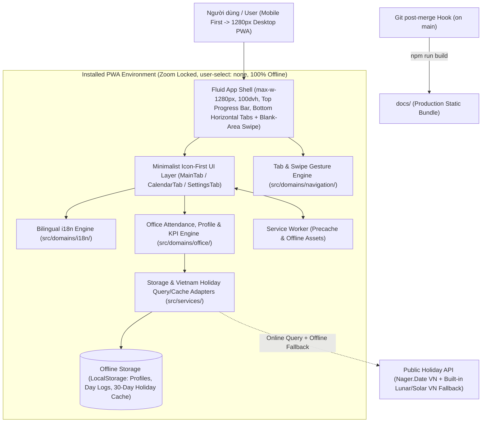

# Master Solution Architecture (SA-MASTER)
**Dự án / Project:** Office Tracker — Ứng dụng Quản lý Lên Văn Phòng Cá Nhân  
**Phiên bản / Version:** 1.0.0  
**Trạng thái / Status:** Đã triển khai (Implemented)  
**Cập nhật lần cuối / Last Updated:** 2026-10-21  

---

## 1. Tổng quan Kiến trúc Hệ thống (System Architecture Overview)
Kiến trúc **Bilingual (VI/EN) Local-First Offline PWA Single Page Application (SPA)** với khung giao diện **Fluid Mobile-First (`<= 1280px`), Icon-Driven Single-Screen (`100dvh`), Persistent Top Progress Bar, Bottom Horizontal Tab Bar & Swipe Gesture Shell**.



---

## 2. Công nghệ Sử dụng (Technology Stack)

| Tầng (Layer) | Công nghệ / Thư viện | Lý do lựa chọn (Tham chiếu ADR) |
| :--- | :--- | :--- |
| **Core Framework** | React 19 + TypeScript (Strict Mode) | Kiểm soát kiểu chặt chẽ, dễ kiểm thử ([ADR-001](adr/ADR-001-local-first-pwa-and-holiday-cache.md)). |
| **UI / Styling & Icons** | Tailwind CSS v4 + `lucide-react` | Thiết kế fluid responsive (`max-w-[1280px]`), `h-dvh`, nút icon trực quan ([ADR-003](adr/ADR-003-fluid-single-screen-ui-and-bottom-tabs.md)). |
| **Navigation & Gestures** | Bottom Horizontal Tab Bar + Custom Blank-Space Touch/Pointer Swipe Detector | Chuyển tab nhanh bằng chạm đáy màn hình hoặc quẹt ngang trên vùng trống ([ADR-003](adr/ADR-003-fluid-single-screen-ui-and-bottom-tabs.md)). |
| **Internationalization (i18n)** | Pure TypeScript Bilingual Engine (`vi` / `en`) | Hỗ trợ song ngữ Việt/Anh 100% offline, type-safe, zero runtime bloat ([ADR-003](adr/ADR-003-fluid-single-screen-ui-and-bottom-tabs.md)). |
| **Domain KPI & Profile Engine** | Pure TypeScript (`src/domains/office/`) | Xử lý hồ sơ 5 thông tin, lịch tuần 7 ngày, cache 30 ngày lễ VN và máy trạng thái nút Lên VP ([ADR-002](adr/ADR-002-employee-profile-and-kpi-engine.md)). |
| **Build & PWA (`docs/`)** | Vite (`build.outDir: 'docs'`) + `vite-plugin-pwa` | Đóng gói SPA và Service Worker chạy offline trực tiếp vào `docs/` ([ADR-001](adr/ADR-001-local-first-pwa-and-holiday-cache.md)). |
| **Git Automation** | `.githooks/post-merge` (`after-merge`) | Tự động build production vào `docs/` ngay sau khi merge vào `main`. |
| **Offline Storage** | `LocalStorage` thông qua `storageService.ts` | Lưu trữ bền vững hồ sơ nhân viên, trạng thái ngày (làm/lên VP/nghỉ phép/kịch bản) và bộ đệm ngày làm việc tháng ([ADR-001](adr/ADR-001-local-first-pwa-and-holiday-cache.md)). |
| **Testing & Coverage** | Vitest + Testing Library + `@vitest/coverage-v8` | Cổng chặn coverage $\ge 90\%$. |

---

## 3. Thiết kế các Phân hệ Cốt lõi (Core Module Architecture)
1. **`src/domains/i18n/`**: Quản lý từ điển song ngữ `vi` (mặc định) và `en`, hỗ trợ nội suy chuỗi cho các thông báo KPI và cảnh báo.
2. **`src/domains/navigation/`**: Xử lý nhận diện cử chỉ quẹt ngang (`swipeTabLogic.ts`) trên vùng trống để chuyển đổi giữa 3 tab (`main`, `calendar`, `settings`).
3. **`src/domains/office/`**:
   * `types.ts`: Định nghĩa cấu trúc dữ liệu `EmployeeProfile` (5 thông tin), `WeekdayConfig`, `DayStatus`, `MonthlyMeasurementCache`, `MonthlyProgressMetrics`, `MainButtonAlertState`.
   * `vietnamHolidays.ts`: Cơ sở dữ liệu ngày lễ Việt Nam (Dương lịch + Âm lịch quy đổi cho giai đoạn 2024–2030) đảm bảo tính toán chính xác cả khi không có mạng.
   * `officeEngine.ts`: Các hàm thuần tính toán số ngày làm việc trong tháng, kiểm tra hiệu lực cache 30 ngày, tính số ngày cần lên VP theo phương pháp tuần/tháng, tính toán thanh progress 3 màu và xác định trạng thái nút "Lên văn phòng" (Xanh lá / Xanh lá sẫm / Cam / Đỏ).
4. **`src/services/`**:
   * `storageService.ts`: Adapter đọc/ghi trạng thái ứng dụng vào `localStorage` an toàn với cơ chế khôi phục mặc định.
   * `holidayService.ts`: Truy vấn thông tin nghỉ lễ Việt Nam từ API công khai (`date.nager.at`) kết hợp bộ dữ liệu lịch lễ Việt Nam nội bộ, đảm bảo 100% chạy offline và tuân thủ quy tắc chỉ đo 1 lần mỗi tháng (đo lại khi mất, đổi lịch tuần, hoặc quá 30 ngày).
5. **`src/components/` & `src/pages/`**:
   * `TopProgressBar.tsx`: Thanh tiến độ cố định trên cùng với 3 dải màu (Xanh lá đậm: đã lên, Xanh lá nhạt: kịch bản tương lai, Vàng: chỉ tiêu cần lên) hỗ trợ chế độ đầy đủ và thu gọn.
   * `MainTab.tsx`: Màn hình chính với nút "Lên văn phòng" biến thiên 4 cấp độ màu/thông điệp và nút "Nghỉ phép" màu trắng bên dưới, kèm công cụ chọn nhanh ngày kịch bản tương lai.
   * `CalendarTab.tsx`: Xem lịch tháng, hiển thị màu sắc ngày (Xám: nghỉ/lễ/nghỉ phép, Xanh: làm việc, Cam: lên VP) và dropdown đổi trạng thái cho ngày làm việc.
   * `SettingsTab.tsx`: Chọn/tạo mới hồ sơ "Loại nhân viên" (5 thông tin) và thanh chỉnh 7 ngày trong tuần (Xám / Vàng / Xanh lá).

---

## 4. Cấu trúc Thư mục Dự án (Repository Structure)
```text
├── README.md                                   # Hướng dẫn tổng quan & Quy tắc SDD/TDD + UI cho tất cả AI Agents
├── index.html                                  # Viewport khóa zoom (user-scalable=no, maximum-scale=1.0)
├── documents/                                  # Toàn bộ tài liệu SDD, ADR, Epic & bản sao Skill
│   ├── BR-MASTER.md
│   ├── SA-MASTER.md
│   ├── adr/
│   ├── epics/
│   └── skills/sdd-tdd-pwa-webapp/
├── docs/                                       # Kết quả build production (tự động cập nhật sau khi merge vào main)
├── .githooks/post-merge                        # Hook after-merge tự động chạy npm run build vào docs/
├── src/
│   ├── domains/
│   │   ├── i18n/
│   │   ├── navigation/
│   │   └── office/
│   ├── services/
│   ├── components/
│   ├── pages/
│   └── sw/
└── tests/
```

---

## 5. Chiến lược Đảm bảo Độ phủ Kiểm thử $\ge 90\%$ (Test Coverage Strategy)
1. **Tách biệt Pure Domain Logic (`src/domains/`) và Browser Side-effects (`src/services/`)**.
2. **Kiểm thử Song ngữ (`vi`/`en`), Swipe Tab & Icon Buttons**: Đảm bảo mọi từ khóa `vi`/`en`, thao tác swipe chuyển tab trên vùng trống, chu kỳ 30 ngày cache ngày lễ và mọi nhánh cảnh báo của nút Lên VP được kiểm thử tự động.
3. **Cổng chặn cứng (`thresholds: 90`) trong `vite.config.ts`**.

---

## 6. Danh mục Hồ sơ Quyết định Kiến trúc (ADR Index)
* [ADR-001: Kiến trúc PWA Offline-First & Cơ chế Truy vấn / Cache 30 Ngày Lịch Nghỉ Lễ Việt Nam](adr/ADR-001-local-first-pwa-and-holiday-cache.md)
* [ADR-002: Thiết kế Hồ sơ Loại Nhân Viên 5 Thông Tin, Lịch 7 Ngày & Máy Trạng Thái Cảnh Báo KPI](adr/ADR-002-employee-profile-and-kpi-engine.md)
* [ADR-003: Giao diện Tối giản 1 Màn hình (`100dvh`), Thanh Progress 3 Màu & Điều hướng Swipe Bottom Tab](adr/ADR-003-fluid-single-screen-ui-and-bottom-tabs.md)
