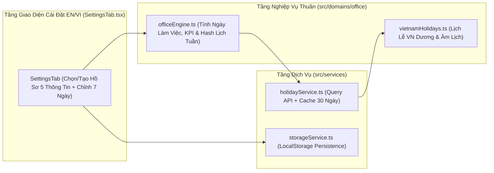

# Solution Architecture — EPIC-01: Hồ sơ Loại Nhân Viên, Cấu hình 7 Ngày & Bộ tính Ngày làm việc / Nghỉ lễ VN

* **Mã Epic:** EPIC-01
* **Tên Epic:** Hồ sơ Loại Nhân Viên, Cấu hình 7 Ngày & Bộ tính Ngày làm việc / Nghỉ lễ VN
* **Trạng thái:** Đã triển khai (Implemented)
* **Liên kết Tài liệu:** [BR-EPIC-01](./BR-EPIC-01.md) | [BR-MASTER](../../BR-MASTER.md) | [SA-MASTER](../../SA-MASTER.md)
* **ADRs Áp dụng:** [ADR-001](../../adr/ADR-001-local-first-pwa-and-holiday-cache.md), [ADR-002](../../adr/ADR-002-employee-profile-and-kpi-engine.md)

---

## 1. Sơ đồ Kiến trúc Thành phần của EPIC-01 (Component Architecture)



---

## 2. Thiết kế Chi tiết các Module Kỹ thuật trong EPIC-01

### 2.1 Cấu trúc Dữ liệu & Interfaces (`src/domains/office/types.ts`)
```ts
export type CalculationMethod = 'monthly' | 'weekly';
export type WeekdaySettingState = 'off' | 'work' | 'office'; // xám: nghỉ, vàng: làm, xanh lá: lên vp
export type WeekdayKey = 'mon' | 'tue' | 'wed' | 'thu' | 'fri' | 'sat' | 'sun';

export interface EmployeeProfile {
  id: string;
  name: string; // (1) Tên nhu cầu
  calculationMethod: CalculationMethod; // (2) Phương pháp tính (theo tuần / theo tháng)
  minRequirementPercent: number; // (3) Yêu cầu tối thiểu (x%)
  weeklySchedule: Record<WeekdayKey, WeekdaySettingState>; // (4) Cấu hình 7 ngày trong tuần
  note: string; // (5) Ghi chú / mô tả
}

export interface MonthlyMeasurementCache {
  monthKey: string; // 'YYYY-MM'
  workingDaysCount: number;
  holidays: HolidayItem[];
  weeklyScheduleHash: string;
  measuredAt: number; // epoch ms
}
```

### 2.2 Khóa Đa Ngôn Ngữ Anh/Việt & Nhãn Icon (`src/domains/i18n/`)
* Cung cấp các khóa dịch cho `SettingsTab`: tên nhu cầu, phương pháp tính (Theo tháng / Theo tuần), yêu cầu tối thiểu (`%`), cấu hình 7 ngày (`T2`..`CN` / `Mon`..`Sun`), trạng thái màu (Xám: Nghỉ, Vàng: Làm, Xanh lá: Ưu tiên VP) và thông tin đo ngày làm việc.

### 2.3 Thuật toán & Logic Nghiệp vụ (`src/domains/office/officeEngine.ts`)
* `cycleWeekdayState(current)`: Chuyển đổi `'off' -> 'work' -> 'office' -> 'off'`.
* `serializeWeeklySchedule(schedule)`: Tạo chuỗi hash đại diện cho cấu hình 7 ngày của hồ sơ.
* `shouldRemeasureMonth(cache, currentSchedule, nowMs)`: Trả về `true` nếu `!cache`, hoặc `cache.weeklyScheduleHash !== serializeWeeklySchedule(currentSchedule)`, hoặc `nowMs - cache.measuredAt > 30 * 24 * 60 * 60 * 1000`.
* `calculateMonthlyWorkingDays(year, month, schedule, holidays)`: Đếm tất cả các ngày trong tháng có thứ thuộc trạng thái `'work'` hoặc `'office'` và không nằm trong danh sách ngày nghỉ lễ Việt Nam `holidays`.

### 2.4 Bố cục Giao diện Fluid Single-Screen & Tương tác (`src/pages/SettingsTab.tsx`)
* Hiển thị bộ chọn Hồ sơ hiện tại, nút mở form tạo hồ sơ mới (5 trường thông tin), thanh 7 nút ngày trong tuần đổi màu trực tiếp (Xám / Vàng / Xanh lá) và thông tin cache số ngày làm việc của tháng.

---

## 3. Kế hoạch Kiểm thử & Ma trận Độ phủ ($\ge 90\%$ Coverage Plan)

| File Kiểm thử | Đối tượng được kiểm thử | Kịch bản kiểm thử chính (Ánh xạ AC trong BR-EPIC-01) |
| :--- | :--- | :--- |
| `tests/officeEngine.test.ts` | `src/domains/office/officeEngine.ts`, `vietnamHolidays.ts` | - Kiểm thử AC-1.1, AC-1.2, AC-2.1, AC-2.2, AC-3.1, AC-3.2 (cache 30 ngày, đổi lịch tuần, mất cache). |
| `tests/services.test.ts` | `src/services/holidayService.ts`, `storageService.ts` | - Kiểm thử truy vấn API lễ VN, fallback offline, đọc/ghi cache 30 ngày và lưu trữ hồ sơ. |
| `tests/appIntegration.test.tsx` | `src/pages/SettingsTab.tsx` | - Kiểm thử đổi hồ sơ, tạo hồ sơ mới 5 thông tin, nhấn đổi màu 7 ngày trong tuần và song ngữ `VI`/`EN`. |
