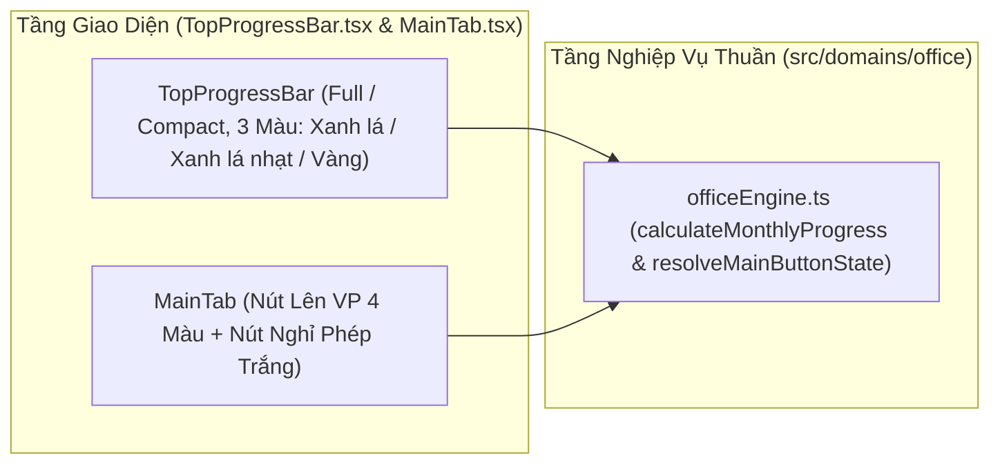

# Solution Architecture — EPIC-02: Thanh Progress 3 Thông số & Tab Chính Đánh dấu Lên VP / Nghỉ phép

* **Mã Epic:** EPIC-02
* **Tên Epic:** Thanh Progress 3 Thông số & Tab Chính Đánh dấu Lên VP / Nghỉ phép
* **Trạng thái:** Đã triển khai (Implemented)
* **Liên kết Tài liệu:** [BR-EPIC-02](./BR-EPIC-02.md) | [BR-MASTER](../../BR-MASTER.md) | [SA-MASTER](../../SA-MASTER.md)
* **ADRs Áp dụng:** [ADR-002](../../adr/ADR-002-employee-profile-and-kpi-engine.md), [ADR-003](../../adr/ADR-003-fluid-single-screen-ui-and-bottom-tabs.md)

---

## 1. Sơ đồ Kiến trúc Thành phần của EPIC-02 (Component Architecture)



---

## 2. Thiết kế Chi tiết các Module Kỹ thuật trong EPIC-02

### 2.1 Cấu trúc Dữ liệu & Interfaces (`src/domains/office/types.ts`)
```ts
export type MainButtonVariant = 'normal' | 'priority' | 'warning' | 'danger';

export interface MonthlyProgressMetrics {
  workingDaysInMonth: number;
  leaveDaysCount: number;
  effectiveWorkingDays: number;
  requiredOfficeDays: number; // Màu vàng
  attendedOfficeDays: number; // Màu xanh lá
  scenarioOfficeDays: number; // Màu xanh lá nhạt
  remainingRequiredDays: number;
  remainingWorkingDaysInMonth: number;
  buttonVariant: MainButtonVariant;
}
```

### 2.2 Khóa Đa Ngôn Ngữ Anh/Việt & Nhãn Icon (`src/domains/i18n/`)
* Khóa dịch cho 3 thông số trên thanh progress (`attendedLabel`, `scenarioLabel`, `requiredLabel`), 4 thông điệp trên nút "Lên văn phòng" (`btnNormal`, `btnPriority`, `btnWarning`, `btnDanger`) và nút "Nghỉ phép" (`btnLeave`).

### 2.3 Thuật toán & Logic Nghiệp vụ (`src/domains/office/officeEngine.ts`)
* `resolveMainButtonState(remainingRequiredDays, remainingWorkingDays, isTodayPriorityOfficeDay)`:
  1. Nếu `remainingRequiredDays > remainingWorkingDays` $\rightarrow$ `'danger'` (Đỏ).
  2. Nếu `remainingRequiredDays > 0 && remainingRequiredDays === remainingWorkingDays` $\rightarrow$ `'warning'` (Cam).
  3. Nếu `isTodayPriorityOfficeDay` $\rightarrow$ `'priority'` (Xanh lá sẫm).
  4. Mặc định $\rightarrow$ `'normal'` (Xanh lá).

### 2.4 Bố cục Giao diện Fluid Single-Screen & Tương tác (`TopProgressBar.tsx`, `MainTab.tsx`)
* `TopProgressBar`: Khi `compact={false}`, hiển thị 3 badge số (Xanh lá / Xanh lá nhạt / Vàng) và thanh bar 3 lớp. Khi `compact={true}`, ẩn hoàn toàn phần số, chỉ giữ thanh bar 3 màu.
* `MainTab`: Nút lớn "Lên văn phòng" ở chính giữa, nút "Nghỉ phép" màu trắng nhỏ hơn ở bên dưới, cùng phần chọn nhanh ngày kịch bản trong tương lai.

---

## 3. Kế hoạch Kiểm thử & Ma trận Độ phủ ($\ge 90\%$ Coverage Plan)

| File Kiểm thử | Đối tượng được kiểm thử | Kịch bản kiểm thử chính (Ánh xạ AC trong BR-EPIC-02) |
| :--- | :--- | :--- |
| `tests/officeEngine.test.ts` | `calculateMonthlyProgress`, `resolveMainButtonState` | - Kiểm thử AC-1.1, AC-2.1, AC-2.2, AC-2.3, AC-2.4 trên mọi biên số ngày còn lại. |
| `tests/appIntegration.test.tsx` | `TopProgressBar.tsx`, `MainTab.tsx` | - Kiểm thử bản đầy đủ vs bản rút gọn, bấm nút "Lên văn phòng", bấm nút "Nghỉ phép" màu trắng và đổi màu nút. |
