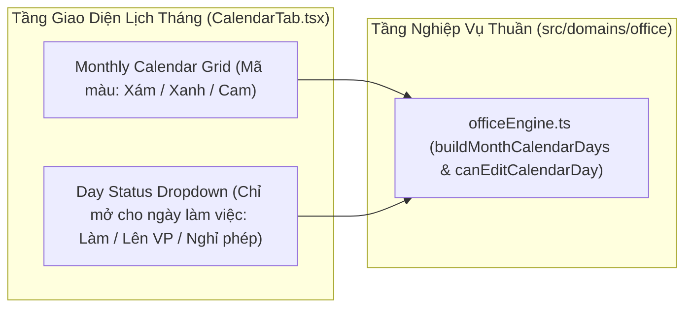

# Solution Architecture — EPIC-03: Lịch Tháng Tương Tác, Dropdown Đổi Trạng Thái & Kịch Bản Tương Lai

* **Mã Epic:** EPIC-03
* **Tên Epic:** Lịch Tháng Tương Tác, Dropdown Đổi Trạng Thái & Kịch Bản Tương Lai
* **Trạng thái:** Đã triển khai (Implemented)
* **Liên kết Tài liệu:** [BR-EPIC-03](./BR-EPIC-03.md) | [BR-MASTER](../../BR-MASTER.md) | [SA-MASTER](../../SA-MASTER.md)
* **ADRs Áp dụng:** [ADR-001](../../adr/ADR-001-local-first-pwa-and-holiday-cache.md), [ADR-003](../../adr/ADR-003-fluid-single-screen-ui-and-bottom-tabs.md)

---

## 1. Sơ đồ Kiến trúc Thành phần của EPIC-03 (Component Architecture)



---

## 2. Thiết kế Chi tiết các Module Kỹ thuật trong EPIC-03

### 2.1 Cấu trúc Dữ liệu & Interfaces (`src/domains/office/types.ts`)
```ts
export type EditableDayStatus = 'work' | 'office' | 'leave';
export type EffectiveDayState = 'off' | 'holiday' | 'leave' | 'work' | 'office';
export type CalendarDayColor = 'gray' | 'blue' | 'orange';

export interface CalendarDayCell {
  dateStr: string; // 'YYYY-MM-DD'
  dayOfMonth: number;
  weekdayKey: WeekdayKey;
  effectiveState: EffectiveDayState;
  color: CalendarDayColor; // 'gray' (nghỉ/lễ/phép), 'blue' (làm), 'orange' (lên vp)
  isEditable: boolean; // false nếu là ngày nghỉ cuối tuần hoặc ngày lễ VN
  isFutureScenario: boolean; // true nếu dateStr > todayStr và effectiveState === 'office'
  holidayName?: string;
}
```

### 2.2 Khóa Đa Ngôn Ngữ Anh/Việt & Nhãn Icon (`src/domains/i18n/`)
* Khóa dịch cho tên các thứ trên lịch, chú thích 3 màu (Xám: Nghỉ/Nghỉ phép, Xanh: Làm việc, Cam: Lên VP), các tùy chọn trong dropdown (`statusWork`, `statusOffice`, `statusLeave`), và thông báo ngày nghỉ/nghỉ lễ bị khóa.

### 2.3 Thuật toán & Logic Nghiệp vụ (`src/domains/office/officeEngine.ts`)
* `buildMonthCalendarDays(year, month, profile, holidays, dayOverrides, todayStr)`:
  * Nếu ngày nằm trong `holidays` $\rightarrow$ `effectiveState = 'holiday'`, `color = 'gray'`, `isEditable = false`.
  * Ngược lại, nếu thứ trong tuần của `profile.weeklySchedule` là `'off'` $\rightarrow$ `effectiveState = 'off'`, `color = 'gray'`, `isEditable = false`.
  * Ngược lại (là ngày làm việc trong tuần):
    * Kiểm tra `dayOverrides[dateStr]`:
      * Nếu `'leave'` $\rightarrow$ `effectiveState = 'leave'`, `color = 'gray'`, `isEditable = true`.
      * Nếu `'office'` $\rightarrow$ `effectiveState = 'office'`, `color = 'orange'`, `isEditable = true`, `isFutureScenario = dateStr > todayStr`.
      * Nếu `'work'` hoặc chưa có override $\rightarrow$ `effectiveState = 'work'`, `color = 'blue'`, `isEditable = true`.

### 2.4 Bố cục Giao diện Fluid Single-Screen & Tương tác (`src/pages/CalendarTab.tsx`)
* Lưới 7 cột tương ứng Thứ 2 $\rightarrow$ Chủ nhật.
* Nhấn vào ô ngày có `isEditable = true` sẽ hiển thị dropdown chọn lại giữa `Làm việc` / `Lên VP` / `Nghỉ phép`. Nhấn vào ô `isEditable = false` sẽ hiển thị nhãn khóa (không mở dropdown đổi trạng thái).

---

## 3. Kế hoạch Kiểm thử & Ma trận Độ phủ ($\ge 90\%$ Coverage Plan)

| File Kiểm thử | Đối tượng được kiểm thử | Kịch bản kiểm thử chính (Ánh xạ AC trong BR-EPIC-03) |
| :--- | :--- | :--- |
| `tests/officeEngine.test.ts` | `buildMonthCalendarDays` | - Kiểm thử AC-1.2, AC-2.1, AC-2.2, AC-3.1 (màu xám/xanh/cam, khóa ngày nghỉ/lễ, ngày kịch bản tương lai). |
| `tests/appIntegration.test.tsx` | `src/pages/CalendarTab.tsx` | - Kiểm thử thanh progress thu gọn trên tab lịch, bấm ngày làm việc mở dropdown đổi sang Lên VP / Nghỉ phép / Làm, bấm ngày nghỉ không mở dropdown. |
