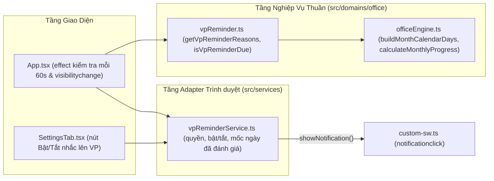

# Solution Architecture — EPIC-04: Nhắc Lên Văn Phòng Hằng Ngày

* **Mã Epic:** EPIC-04
* **Tên Epic:** Nhắc Lên Văn Phòng Hằng Ngày
* **Trạng thái:** Đã triển khai (Implemented)
* **Liên kết Tài liệu:** [BR-EPIC-04](./BR-EPIC-04.md) | [BR-MASTER](../../BR-MASTER.md) | [SA-MASTER](../../SA-MASTER.md)
* **ADRs Áp dụng:** [ADR-001](../../adr/ADR-001-local-first-pwa-and-holiday-cache.md), [ADR-002](../../adr/ADR-002-employee-profile-and-kpi-engine.md), [ADR-004](../../adr/ADR-004-daily-vp-reminder-notifications.md)

---

## 1. Sơ đồ Kiến trúc Thành phần của EPIC-04 (Component Architecture)



---

## 2. Thiết kế Chi tiết các Module Kỹ thuật trong EPIC-04

### 2.1 Kiểu dữ liệu & Hằng số
```ts
// src/domains/office/vpReminder.ts
export const VP_REMINDER_HOUR = 7; // giờ địa phương

export type VpReminderReason = 'quota-at-risk' | 'planned-today' | 'priority-quota-open';

// src/services/vpReminderService.ts
export type VpReminderStatus = 'on' | 'off' | 'blocked' | 'unsupported';
```

Khóa `localStorage` (qua `vpReminderService.ts`, bọc try/catch):
* `office_tracker_vp_reminder_enabled`: `'1'` | `'0'`.
* `office_tracker_vp_reminder_last_date`: `'YYYY-MM-DD'` của lần đánh giá gần nhất.

### 2.2 Thuật toán (`src/domains/office/vpReminder.ts`)
* `getVpReminderReasons(profile, measurement, dayLogs, todayStr): VpReminderReason[]`:
  1. Tính `cells` và `metrics` của tháng hiện tại bằng đúng các hàm của `officeEngine.ts`.
  2. Lấy ô của hôm nay. Nếu không tồn tại, hoặc `isEditable === false`, hoặc không phải (`effectiveState === 'work'` hoặc `isPlanned`) $\rightarrow$ trả về `[]` (cuối tuần, lễ, nghỉ phép, đã lên VP).
  3. Theo thứ tự, đẩy các lý do:
     * `quota-at-risk` nếu `remainingRequiredDays > 0` và `remainingRequiredDays >= remainingWorkingDaysInMonth`.
     * `planned-today` nếu `isPlanned`.
     * `priority-quota-open` nếu `isPriorityDay` và `remainingRequiredDays > 0`.
* `isVpReminderDue(now, todayStr, lastSentDate)`: `true` khi `now.getHours() >= 7` và `lastSentDate !== todayStr`.

### 2.3 Luồng Đánh giá trong `App.tsx`
1. Chỉ tiếp tục khi `getVpReminderStatus() === 'on'`.
2. Nếu `isVpReminderDue` đúng: ghi `todayStr` vào `last_date` **trước** khi đánh giá (đảm bảo mỗi ngày chỉ đánh giá một lần).
3. Dùng số ngày làm việc của **tháng hiện tại** (`monthlyCache` nếu còn hợp lệ, nếu không thì `buildInstantMonthMeasurement`), không dùng tháng đang xem trên lịch.
4. Nếu có lý do: gửi đúng một thông báo với nội dung theo `reasons[0]`.

### 2.4 Thông báo & Service Worker (`src/services/vpReminderService.ts`, `src/sw/custom-sw.ts`)
* `showVpReminderNotification(title, body)`: dùng `navigator.serviceWorker.ready` $\rightarrow$ `registration.showNotification(title, { body, tag: 'vp-reminder', icon: 'icon-192.png' })`. Không có service worker thì dùng `new Notification(...)`. Lỗi được nuốt (nhắc là best-effort).
* `custom-sw.ts`: `notificationclick` đóng thông báo, focus cửa sổ app đang mở hoặc mở `./` nếu chưa có.

### 2.5 Giao diện Cài đặt (`src/pages/SettingsTab.tsx`)
* Một khối (section) nằm trên lưới 7 ngày: tiêu đề, mô tả ngắn, thông báo trạng thái (`blocked` / `unsupported`) và một nút toàn chiều rộng (`data-testid="btn-toggle-vp-reminder"`, `aria-pressed` phản ánh trạng thái bật).
* Nút bị vô hiệu hóa khi `unsupported` hoặc `blocked`.

### 2.6 Khóa Đa Ngôn Ngữ (`src/domains/i18n/`)
`vpReminderTitle`, `vpReminderDesc`, `vpReminderOn`, `vpReminderOff`, `vpReminderBlocked`, `vpReminderUnsupported`, `vpReminderNotifTitle`, `vpReminderBodyAtRisk`, `vpReminderBodyPlanned`, `vpReminderBodyPriority` — đủ cả `vi` và `en`.

---

## 3. Kế hoạch Kiểm thử & Ma trận Độ phủ ($\ge 90\%$ Coverage Plan)

| File Kiểm thử | Đối tượng được kiểm thử | Kịch bản kiểm thử chính (Ánh xạ AC trong BR-EPIC-04) |
| :--- | :--- | :--- |
| `tests/vpReminder.test.ts` | `getVpReminderReasons`, `isVpReminderDue` | Điều kiện nhắc, không nhắc cuối tuần/lễ/nghỉ phép/đã lên VP (AC-3.1, AC-3.3); thứ tự lý do (AC-3.2); khung giờ 7:00 và một lần/ngày (AC-2.1, AC-2.2, AC-2.4). |
| `tests/vpReminderService.test.ts` | `vpReminderService.ts` | Trạng thái `unsupported` / `blocked` / `on` / `off`, xin quyền từ thao tác người dùng (AC-1.1, AC-1.2, AC-1.3, AC-1.4), fallback `new Notification` và hiển thị qua service worker. |
| `tests/vpReminderIntegration.test.tsx` | `App.tsx`, `SettingsTab.tsx` | Gửi đúng một lần lúc 7:00 (AC-2.2, AC-2.4), không gửi trước 7:00 (AC-2.1), một thông báo khi nhiều lý do (AC-3.2), không gửi cuối tuần (AC-3.1), nút bật/tắt và thông báo bị chặn/không hỗ trợ (AC-1.2, AC-1.3, AC-1.4). |

Coverage đo bằng `npm run test:coverage`, ngưỡng chung 90% được cấu hình trong `vite.config.ts`.
